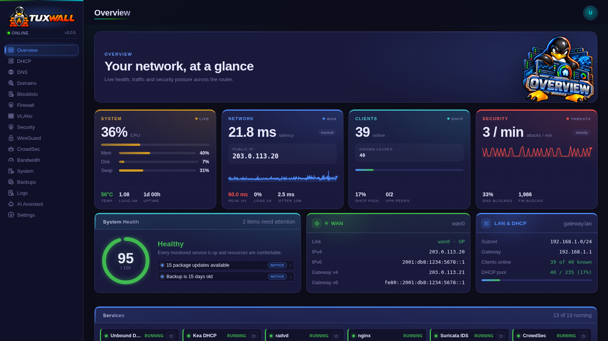
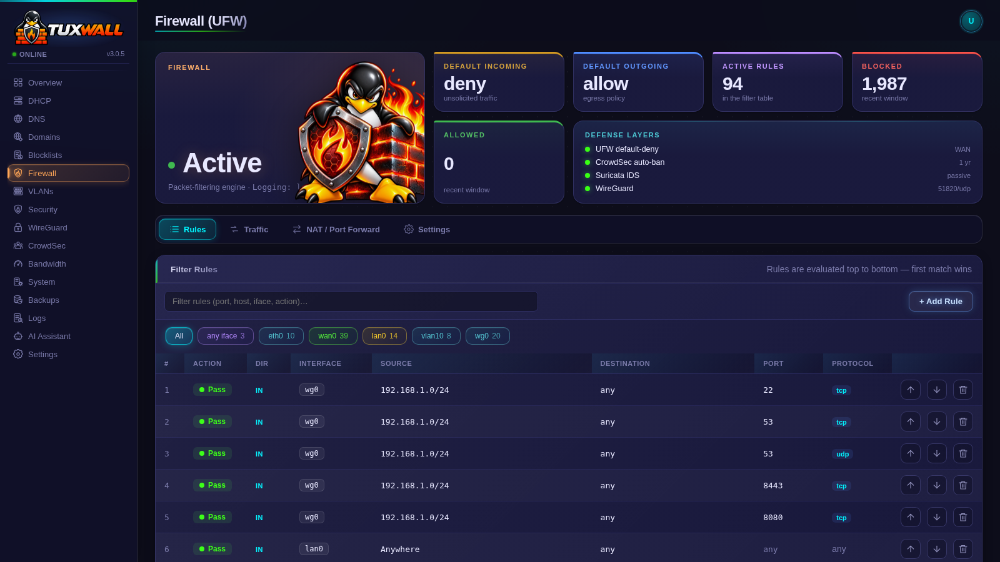
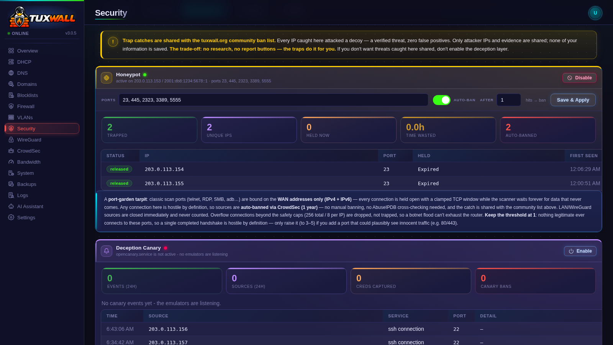
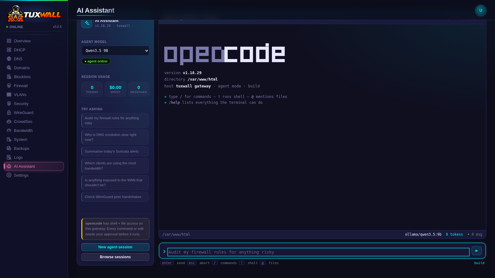
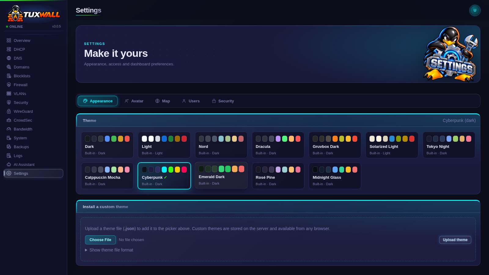

<p align="center">
  
</p>

<p align="center">
  <strong>Turn any Ubuntu server into an open-source Linux firewall and router.</strong><br>
  DHCP, DNS filtering, firewall rules, WireGuard, intrusion detection, deception and an AI assistant — in one browser tab on hardware you own.
</p>

<p align="center">
  <a href="https://github.com/rezzonance/tuxwall/releases"></a>
  <a href="#license"></a>
  <a href="#requirements"></a>
  <a href="https://tuxwall.org"></a>
  <a href="https://forum.tuxwall.org"></a>
</p>

---

TuxWall is a web-based network dashboard for a **dedicated Linux gateway or router** — a headless machine sitting between your modem and your LAN switch, doing the real work.

It does not replace your networking services. It **reads from and controls** Kea, Unbound, UFW, WireGuard, Suricata, CrowdSec and radvd through one unified interface, while every setting remains a standard, inspectable file on disk.

The base is stock Ubuntu. `apt`, `systemd`, `journalctl` and every tool you already know keep working. Install TuxWall, and your gateway keeps routing; remove it, and the underlying services keep running.

**[Website](https://tuxwall.org) · [Feature guide](https://tuxwall.org/help.html) · [Config reference](https://tuxwall.org/configs.html) · [Community forum](https://forum.tuxwall.org) · [Community bans](https://tuxwall.org/bans)**

## Table of Contents

- [Why TuxWall](#why-tuxwall)
- [Screenshots](#screenshots)
- [Features](#features)
- [How it fits together](#how-it-fits-together)
- [Requirements](#requirements)
- [Installation](#installation)
- [Install from USB (netinstaller)](#install-from-usb-netinstaller)
- [Run as a VM](#run-as-a-vm)
- [First login](#first-login)
- [Configuration](#configuration)
- [HTTPS for the dashboard](#https-for-the-dashboard)
- [Plugins](#plugins)
- [AI assistant](#ai-assistant)
- [Security and community data](#security-and-community-data)
- [Device monitoring](#device-monitoring)
- [Updating and removing](#updating-and-removing)
- [Troubleshooting](#troubleshooting)
- [Support the project](#support-the-project)
- [Contributing](#contributing)
- [License](#license)

---

## Why TuxWall

- **No custom distro.** Stock Ubuntu LTS underneath. No appliance image to learn, no vendor kernel, no locked bootloader.
- **No lock-in.** TuxWall drives standard services with their standard configs. Uninstall the dashboard and your gateway is still a Linux gateway.
- **Safe to experiment.** Firewall baselines can be restored atomically, so a bad rule does not lock you out of your own network.
- **One pane of glass.** DHCP, DNS, firewall, VPN, IDS, traffic shaping, users and backups share a single UI and a single login.
- **Works from first boot.** The package writes working defaults for Kea, Unbound, radvd, forwarding/NAT and UFW on a fresh install. Hand-tuned configs are never clobbered on upgrade.

## Screenshots



<p align="center"><em>Overview — live health, traffic, services and security posture at a glance.</em></p>

<p align="center">
  <a href="images/screenshots/latest-firewall.png"></a>
  <a href="images/screenshots/latest-deception.png"></a>
</p>
<p align="center"><em>Firewall — interface filters and colour-coded rules. &nbsp;·&nbsp; Deception — honeypot and canary traps.</em></p>

<p align="center">
  <a href="images/screenshots/latest-ai.png"></a>
  <a href="images/screenshots/latest-settings.png"></a>
</p>
<p align="center"><em>AI Assistant — the opencode agent on your gateway. &nbsp;·&nbsp; Settings — themes, users and two-factor authentication.</em></p>

## Features

### Routing and firewall

| Feature | What it does | Under the hood |
|---|---|---|
| **Firewall rules** | View, add, remove and reorder rules; inspect the live backend. | UFW, nftables, iptables |
| **VLANs and DMZ** | Create segmented networks and inter-VLAN policies from the UI. | UFW route rules, netplan |
| **NAT and forwarding** | Persisted WAN masquerade and LAN-to-WAN forwarding on a default-deny posture. | UFW, sysctl |
| **Traffic shaping** | CAKE qdisc for bufferbloat reduction and per-host fairness, with a guided speed test. | `tc`, CAKE |
| **Restore baselines** | Save and restore known-good firewall rulesets with atomic rollback. | `iptables-restore` |

### Addressing and DNS

| Feature | What it does | Under the hood |
|---|---|---|
| **DHCP leases and reservations** | Live active/expired leases, static reservations and per-interface pools. | Kea DHCPv4 |
| **IPv6 router advertisements** | Advertise prefixes and DNS to the LAN; track ISP prefix delegation. | radvd, DHCPv6-PD, SLAAC |
| **DNS filtering** | Recursive resolution, local domains, blocklists and RPZ policies with hot reload. | Unbound |
| **DNS upstreams** | Eleven presets plus custom LAN resolvers, with DNS-over-TLS support. | Unbound `forward-zone` |
| **Threat feeds** | Subscribe to blocklist and RPZ feeds with automatic refresh. | Unbound, RPZ |

### Security and visibility

| Feature | What it does | Under the hood |
|---|---|---|
| **Intrusion detection** | Network threat detection on WAN and LAN with daily rule updates. | Suricata IDS/IPS |
| **Collaborative blocking** | Local decisions and community threat intelligence with automatic bans. | CrowdSec |
| **Honeypot tarpit** | WAN-only port garden that holds scanners open and auto-bans completed handshakes. | Built into the dashboard |
| **Deception canaries** | SSH, VNC, MSSQL and Redis emulators (WAN IPv4) that capture credential sprays. | OpenCanary |
| **File integrity** | Baseline and nightly AIDE checks with section-aware change reporting. | AIDE |
| **Device monitoring** | Every LAN/VLAN/VPN device with health, risk score and findings: known C2 / malware contacts, Suricata alerts per device, new devices. | Zeek, Suricata, abuse.ch feeds |
| **Attack map and bandwidth** | Live attacker geography, per-client traffic and top talkers. | Leaflet, nftables counters |
| **Community bans** | Trap catches are shared as verified threat evidence and consumed as a public ban list. | tuxwall.org collector |

### Management

| Feature | What it does | Under the hood |
|---|---|---|
| **AI assistant** | An embedded agent that can inspect the box, audit rules and edit configs — with approval for every action. | opencode |
| **Users and 2FA** | Per-user admin rights, TOTP enrollment with QR codes and replay protection. | Built into the dashboard |
| **Backups and restore** | Full-system archives, include/exclude lists, single-file restore and sanitized exports. | rsync, tar, systemd |
| **Themes** | Twelve built-in themes plus custom JSON themes and a profile avatar. | Built into the dashboard |
| **Plugins** | Isolated extensions for access points, certificates and external exposure checks. | Sandboxed worker processes |
| **System info and updates** | Platform, CPU, memory, storage, network, service controls and package updates. | systemd, apt, `/api/system` |
| **Diagnostics** | Connectivity checks, service status, logs and firewall safety tools. | Built into the dashboard |

## How it fits together

```text
Browser (LAN or VPN)
        │  HTTP :80
        ▼
      nginx ──► tuxwall API (Python, loopback :8008)
                    │
                    ├── Kea DHCPv4 / radvd
                    ├── Unbound  (DNS, blocklists, RPZ)
                    ├── UFW / nftables / iptables
                    ├── WireGuard
                    ├── Suricata + CrowdSec
                    └── opencode agent (loopback :4096)
```

The dashboard is served by nginx from `/var/www/html`; the Python API runs as `tuxwall.service` on `127.0.0.1:8008`. nginx is configured to allow loopback, RFC1918 and `fd00::/8` clients only, so the dashboard is reachable from your LAN and WireGuard network, not from the WAN.

## Requirements

- **Ubuntu 24.04 LTS or newer** on x86_64. Ubuntu **26.04 LTS** is the current recommendation. A stock server install is enough; the [netinstaller](#install-from-usb-netinstaller) and the [VM image](#run-as-a-vm) are optional shortcuts that set up exactly that (stock Ubuntu + TuxWall from the signed APT repository).
- **Two network interfaces:** one for **WAN** (modem/ONT) and one for **LAN** (switch/access points). A VM with two virtual NICs also works for testing.
- **Root or sudo access** and an internet connection during installation.
- The machine should be your network's gateway. For a typical setup, put the ISP modem in bridge mode and give the WAN interface a DHCP or static address.

**Hardware:** x86_64 (amd64), BIOS or UEFI (Secure Boot can stay on), 2 wired network ports, **16 GB+ disk**, **4 GB RAM** recommended (2 GB runs the gateway without the heavier extras). The netinstaller's default *download* entry keeps the 2.9 GB Ubuntu installer image in RAM and needs **6 GB+ RAM** (4 GB fails, 5 GB is the bare minimum); on smaller boxes use one of its *low RAM* entries.

TuxWall is designed for a dedicated gateway. Running it on your desktop or on a machine that is not the default gateway will work as a dashboard, but routing, DHCP and DNS features will not apply to your network as intended.

## Installation

There is one installer with three sources (build from this repository, the signed APT repository, or a `.deb` file) and two roles: **gateway** configures WAN/LAN, DHCP, DNS, IPv6, NAT and the firewall; **dashboard** installs TuxWall without touching the machine's network. Every source ends in the same package, so they are equivalent.

```bash
curl -fsSL https://tuxwall.org/downloads/tuxwall-install.sh -o tuxwall-install.sh
sudo bash tuxwall-install.sh --dry-run   # see the full plan first
sudo bash tuxwall-install.sh             # guided install, review screen included
```

No Ubuntu on the box yet? Use the [netinstaller](#install-from-usb-netinstaller) (USB stick) or the [VM image](#run-as-a-vm) instead: both install stock Ubuntu 26.04 LTS and then ask for the WAN/LAN ports on the first boot.

From a repository clone, run `sudo bash tuxwall-install.sh` instead (it defaults to building the package from your checkout). For headless or fresh-appliance installs, `sudo bash tuxwall-install.sh --console` stages a one-time first-boot wizard on the console. Unattended installs pass `--yes` with `--wan`/`--lan` and the options from `--help`.

**Firewall defaults (gateway):** incoming traffic is denied by default; SSH and the dashboard are allowed from the LAN only, never on the WAN. If you run the installer over an SSH session that arrives on the WAN, that session stays open, but new SSH logins must come from the LAN (pass `--ssh-wan` to keep a rate-limited SSH rule on the WAN; Firewall → Findings flags it). WireGuard's port (51820/udp) is opened on the WAN only when you set WireGuard up on the VPN page, together with SSH and DNS from the VPN subnets. Upgrades do not apply these defaults to an existing install: rules that already open SSH or WireGuard on the WAN stay, and Firewall → Findings keeps flagging them until you scope or remove them.

**WAN on DHCP behind another router:** systemd-networkd (what netplan uses on Ubuntu Server) sends its DUID as the DHCPv4 client identifier by default, not the MAC address. An upstream router or ISP box with a MAC-based address reservation may therefore not recognise the TuxWall WAN and hand out a different address after a reboot. Either make the WAN identify itself by MAC — netplan: `dhcp-identifier: mac` under the WAN interface (then `sudo netplan apply`); plain systemd-networkd: `ClientIdentifier=mac` in the WAN's `[DHCPv4]` section — or create the upstream reservation for the client ID/DUID the TuxWall WAN actually sends.

Future updates are normal APT updates:

```bash
sudo apt update && sudo apt upgrade tuxwall
```

> **Optional packages:** CrowdSec, its firewall bouncer, GeoIP and the Ookla speedtest are shipped as `Suggests`, so a bare APT install does not pull them in. The installer offers them during setup; to add them by hand:
>
> ```bash
> sudo apt install crowdsec crowdsec-firewall-bouncer-nftables python3-maxminddb
> ```

<details>
<summary>Manual APT setup (if you prefer not to pipe a script)</summary>

```bash
curl -fsSL https://rezzonance.github.io/tuxwall/public.asc \
  | sudo gpg --dearmor -o /usr/share/keyrings/tuxwall.gpg

echo "deb [signed-by=/usr/share/keyrings/tuxwall.gpg] https://rezzonance.github.io/tuxwall stable main" \
  | sudo tee /etc/apt/sources.list.d/tuxwall.list

sudo apt update
sudo apt install tuxwall
```
</details>

<details>
<summary>Manual .deb install</summary>

Download the current package, `SHA256SUMS` and `SHA256SUMS.asc` from [Releases](https://github.com/rezzonance/tuxwall/releases) and check them ([SECURITY.md](SECURITY.md#verifying-releases)), then:

```bash
sudo bash tuxwall-install.sh --deb tuxwall_3.3.7_all.deb
# or the classic way:
sudo dpkg -i tuxwall_3.3.7_all.deb && sudo apt -f install
```
</details>

### Verify the install

```bash
systemctl --no-pager -l status \
  tuxwall nginx unbound kea-dhcp4-server radvd suricata
```

If CrowdSec is installed, include it as well:

```bash
systemctl status crowdsec
```

Then open the dashboard from a device on your LAN or VPN:

```text
https://<gateway-lan-ip>/
```

Plain `http://` redirects there. Until your device trusts the router's own certificate authority the browser shows a certificate warning - see [HTTPS for the dashboard](#https-for-the-dashboard).

### Optional configuration

The dashboard covers day-to-day changes. For a complete reference of every config file TuxWall touches — netplan, sysctl, UFW, Kea, Unbound, radvd, WireGuard, nginx, systemd and the opencode agent — see **[tuxwall.org/configs.html](https://tuxwall.org/configs.html)**. The site also includes a gateway config generator if you prefer to build the files yourself.

## Install from USB (netinstaller)

`tuxwall-netinstall-<version>-amd64.iso` (~130 MB) turns a spare box into a TuxWall gateway without installing Ubuntu by hand. It is **Ubuntu's own installer**: the boot chain (Ubuntu's signed shim, GRUB and kernel) is taken unchanged from the official Ubuntu 26.04.1 live-server ISO, which it downloads from releases.ubuntu.com over HTTPS (or finds on a second stick) and checks against a pinned SHA-256 before anything is installed. TuxWall is set up on the first boot from the signed APT repository. Details: [image/netinstall/README.md](image/netinstall/README.md).

**1. Download and verify** `tuxwall-netinstall-<version>-amd64.iso`, `SHA256SUMS` and `SHA256SUMS.asc` from [Releases](https://github.com/rezzonance/tuxwall/releases):

```bash
curl -fsSL https://rezzonance.github.io/tuxwall/public.asc | gpg --import   # fingerprint 5D79 B908 2DCA EB9C CB73 1382 F5D8 2357 16BD BDD1
gpg --verify SHA256SUMS.asc SHA256SUMS                                       # "Good signature" from that key
sha256sum -c --ignore-missing SHA256SUMS                                     # "tuxwall-netinstall-...iso: OK"
```

On Windows, `certutil -hashfile tuxwall-netinstall-<version>-amd64.iso SHA256` prints the hash to compare with `SHA256SUMS`.

**2. Write it to a USB stick** (everything on the stick is erased): [balenaEtcher](https://etcher.balena.io/) (any OS), [Rufus](https://rufus.ie/) (Windows - choose *Write in DD Image mode* when asked), or on Linux:

```bash
lsblk                                   # find the stick, e.g. /dev/sdX (not a partition like /dev/sdX1)
sudo dd if=tuxwall-netinstall-<version>-amd64.iso of=/dev/sdX bs=4M conv=fsync status=progress
```

**3. Boot the box from the stick** (boot menu key, often F12, F11, F8 or Esc). BIOS and UEFI both work, and **Secure Boot can stay on**. Plug the WAN port into your modem/router first: the default entry needs internet by DHCP. The menu:

| Entry | Use it when |
|---|---|
| **Install TuxWall (downloads Ubuntu 26.04.1 into RAM: needs 6 GB+ RAM)** | Default. Downloads the 2.9 GB Ubuntu installer over HTTPS into RAM. |
| Install TuxWall - Ubuntu ISO written to a second USB stick (low RAM) | Less than 6 GB RAM: write `ubuntu-26.04.1-live-server-amd64.iso` from [releases.ubuntu.com](https://releases.ubuntu.com/26.04.1/) to a second stick (same tools as above) and plug both in. Needs only normal installer RAM (about 4 GB). |
| Install TuxWall - Ubuntu ISO file on another USB stick / disk (low RAM) | Same, but with the `.iso` **file** copied to the top folder of any other stick or disk (exFAT, FAT32 or ext4). |
| Install TuxWall - download from old-releases.ubuntu.com | The first entry fails because Ubuntu has published a newer point release. |
| Serial console (ttyS0, 115200 baud) ... | Headless boxes with a serial console. |
| Help: which entry? | A short version of this table on the screen. |

The low-RAM entries need exactly that Ubuntu ISO (its SHA-256 is checked; a different one stops the install with a message).

**4. Install Ubuntu.** Ubuntu's installer asks for the language, keyboard, **disk**, your user account and SSH. **It always asks before using a disk:** it lists every disk with size and model (the TuxWall stick is hidden), and nothing is written until you confirm its *Confirm destructive action* dialog. No password is preset - you choose it. After the install, remove the stick and reboot.

**5. First boot: TuxWall setup.** The screen (and the serial console) shows *Press Enter to start the setup*. It asks for the **WAN port** (or *Detect*: plug the modem cable in when asked), DHCP / static / keep, the **LAN port** and network (192.168.1.1/24 unless that collides with the WAN), and optionally the dashboard administrator, then installs TuxWall from the signed APT repository (a few minutes). At the end it shows the **dashboard URL and the router CA's SHA-256 fingerprint**; both stay above the console login prompt. Type `skip` to get a normal login instead; run the setup again any time with `sudo tuxwall-setup`.

## Run as a VM

`tuxwall-vm-<version>-amd64.qcow2` (~820 MB, 16 GB virtual disk) is the **official Ubuntu 26.04 LTS cloud image**, signature-verified and otherwise unchanged, plus the TuxWall first-boot setup (`tuxwall-setup`, `tuxwall-install.sh` and the signed APT source). TuxWall itself is installed by that setup on the first boot from the APT repository, so the image stays small and you always get the current release. Verify it with `SHA256SUMS` / `SHA256SUMS.asc` like the netinstaller above.

The VM needs: x86_64 KVM (Proxmox VE, libvirt, plain QEMU), 2 vCPUs, 4 GB RAM, UEFI (Secure Boot works) or BIOS, and **two virtual NICs: the first is the WAN, the second the LAN**. Like every Ubuntu cloud image it has **no default login**: give it a user and SSH key through cloud-init (Proxmox's cloud-init drive or a NoCloud seed). Without a network config, cloud-init uses DHCP on the first NIC; leave the LAN NIC unconfigured - the setup does it.

**Proxmox VE** (on the Proxmox host, as root; adjust the VM id, storage and bridges):

```bash
wget https://github.com/rezzonance/tuxwall/releases/download/v<version>/tuxwall-vm-<version>-amd64.qcow2
qm create 200 --name tuxwall --ostype l26 --machine q35 --bios ovmf --cpu host --cores 2 --memory 4096 \
  --efidisk0 local-lvm:1,efitype=4m,pre-enrolled-keys=1 --scsihw virtio-scsi-single \
  --scsi0 local-lvm:0,import-from=/root/tuxwall-vm-<version>-amd64.qcow2,discard=on --boot order=scsi0 \
  --net0 virtio,bridge=vmbr0 --net1 virtio,bridge=vmbr1 --serial0 socket --vga std \
  --ide2 local-lvm:cloudinit --ciuser admin --sshkeys /root/.ssh/id_ed25519.pub --ipconfig0 ip=dhcp
qm start 200
```

`vmbr0` is the bridge towards your modem (WAN), `vmbr1` the bridge with your LAN devices. In the web UI the same works with *Datacenter → Storage → (a directory storage) → Content: Import*, uploading the `.qcow2` there and choosing it as the *Import* source of the VM's disk; set *User*, *SSH public key* and *IP Config (net0): DHCP* on the VM's *Cloud-Init* tab and leave net1 unset. Then open the VM's console (noVNC, or xterm.js on the serial port) and press Enter for the TuxWall setup. With Proxmox's *Upgrade packages* cloud-init option (on by default) the setup appears a few minutes later, once the upgrade is done. The setup keeps the NIC names it sees (Proxmox's cloud-init config would rename them at the next boot) and turns cloud-init's network handling off, so later edits on the *Cloud-Init* tab no longer touch the network.

**libvirt / plain QEMU** with a NoCloud seed (`cloud-localds` is in the `cloud-image-utils` package):

```bash
cat >user-data <<'EOF'
#cloud-config
users:
  - name: admin
    groups: [sudo]
    shell: /bin/bash
    sudo: "ALL=(ALL) NOPASSWD:ALL"
    ssh_authorized_keys: ["ssh-ed25519 AAAA... you@example"]
EOF
printf 'instance-id: tuxwall-1\nlocal-hostname: tuxwall\n' >meta-data
cloud-localds seed.iso user-data meta-data
virt-install --name tuxwall --memory 4096 --vcpus 2 --boot uefi --osinfo linux2022 --import \
  --disk tuxwall-vm-<version>-amd64.qcow2,bus=virtio --disk seed.iso,device=cdrom \
  --network bridge=br-wan,model=virtio --network bridge=br-lan,model=virtio
```

**Headless (no console):** put the setup's answers into the cloud-init user-data; the first boot then runs the setup unattended (also when the file appears later, while the console waits) and shows the result on the console and its login screen:

```yaml
#cloud-config
users:
  - name: admin
    groups: [sudo]
    shell: /bin/bash
    sudo: "ALL=(ALL) NOPASSWD:ALL"
    ssh_authorized_keys: ["ssh-ed25519 AAAA... you@example"]
write_files:
  - path: /etc/tuxwall/setup-answers
    permissions: "0600"
    content: |
      # ports by MAC address (or WAN=ens18 / LAN=ens19)
      WAN_MAC=52:54:00:aa:bb:01
      WAN_MODE=dhcp
      LAN_MAC=52:54:00:aa:bb:02
      LAN_SUBNET=192.168.1.1/24
      ADMIN_USER=admin
      ADMIN_PASSWORD_FILE=/etc/tuxwall/admin-password
  - path: /etc/tuxwall/admin-password
    permissions: "0600"
    content: "use-a-long-random-password"
```

Answer keys: `WAN`/`WAN_MAC`, `WAN_MODE` (`dhcp`, `static` with `WAN_ADDRESS=203.0.113.10/24`, `WAN_GATEWAY`, `WAN_DNS=9.9.9.9,1.1.1.1`, or `keep`), `LAN`/`LAN_MAC`, `LAN_SUBNET`, `ADMIN_USER` + `ADMIN_PASSWORD_FILE` (deleted after use), `ROLE=dashboard` (no routing) and `EXTRA` (`--no-crowdsec --no-agent --no-speedtest --no-geoip --ssh-wan`). Check a file with `tuxwall-setup --answers FILE --print-command`. cloud-init keeps its own copy of the user-data (root-only, under `/var/lib/cloud/`), so change the administrator password in the dashboard afterwards. On Proxmox, custom user-data goes in with `qm set 200 --cicustom user=local:snippets/tuxwall-user.yaml` (a storage with the *Snippets* content type); it replaces the *Cloud-Init* tab's user and key, so put the user in that file.

## First login

There are **no default credentials**. On a fresh install, the dashboard opens a one-time administrator setup page:

1. Create the first administrator account with a strong password.
2. Sign in and open **Settings → Users** to add any additional admins or read-only viewers.
3. Enroll TOTP in **Settings** if you want two-factor authentication.
4. Review **Settings → Plugins** to enable optional integrations.

The dashboard is restricted to your LAN/VPN by nginx. If you cannot reach it, confirm the LAN interface has an address and that nginx is running:

```bash
ip -br address
systemctl status nginx
```

## Configuration

Most settings are available from the dashboard and are written directly to the underlying service's standard config file. You can hand-edit those files at any time; TuxWall reads the result on the next reload.

| Path | Purpose |
|---|---|
| `/etc/tuxwall/` | Dashboard settings, `opencode.json` + `opencode.local.json`, `llm.json`, `sqm.conf` |
| `/etc/unbound/unbound.conf.d/` | DNS, local domains, blocklists and RPZ zones |
| `/etc/kea/kea-dhcp4.conf` | DHCP subnets, pools and reservations |
| `/etc/tuxwall/radvd.conf` | IPv6 router advertisements (radvd reads it through `/etc/systemd/system/radvd.service.d/10-tuxwall.conf`; installs that were not migrated still use `/etc/radvd.conf`) |
| `/etc/ufw/` | Firewall and NAT rules |
| `/etc/wireguard/wg0.conf` | WireGuard interface and peers |
| `/etc/suricata/suricata.yaml` | IDS/IPS interfaces and HOME_NET |
| `/etc/nginx/sites-available/tuxwall` | Dashboard vhost and LAN/VPN access lists |
| `/etc/tuxwall/tls/`, `/etc/tuxwall/https.json` | Dashboard HTTPS certificates and settings (see [HTTPS for the dashboard](#https-for-the-dashboard)) |

Useful service commands:

```bash
sudo systemctl restart tuxwall          # dashboard API
sudo systemctl reload nginx             # dashboard vhost
sudo systemctl restart kea-dhcp4-server # DHCP
sudo systemctl restart unbound          # DNS
sudo systemctl restart radvd            # IPv6 RAs
```

For traffic shaping, set the WAN interface and rates from **System → Traffic Shaping**, or edit `/etc/tuxwall/sqm.conf` and run:

```bash
sudo /usr/local/sbin/tuxwall-sqm.sh --dry-run   # print the tc commands, change nothing
sudo systemctl enable --now tuxwall-sqm
```

## HTTPS for the dashboard

The dashboard is served over HTTPS by default (new installs and upgrades). Each router gets its own small certificate authority (CA) and a server certificate signed by it:

| Path | Purpose |
|---|---|
| `/etc/tuxwall/tls/ca.crt` | The router's CA - trust this on your devices (also at `http://<router>/tuxwall-ca.crt` and **Settings → Security → HTTPS → Download CA certificate**) |
| `/etc/tuxwall/tls/ca.key`, `server.key` | Private keys (root only, `0600`) |
| `/etc/tuxwall/tls/server.crt` | Server certificate: 397 days, names = LAN/VLAN/VPN IPv4 + ULA addresses, host name, `<host>.local`, the router's domain and local DNS names pointing at the router |
| `/etc/nginx/snippets/tuxwall-tls.conf` | Generated nginx include: port 443 with TLS (`default_server` on the dashboard's LAN/VPN addresses; wildcard sockets so a missing address, e.g. WireGuard down, never stops nginx), the CA download, the http → https redirect on those addresses |
| `/etc/tuxwall/https.json` | Settings (HTTPS on/off, redirect, HSTS, your own certificate) |

- **Trusting the CA** removes the browser warning. The card under **Settings → Security → HTTPS** shows the CA's SHA-256 fingerprint and short steps for Windows, macOS, iOS, Android, Linux and Firefox. The CA is name-constrained: it can only vouch for private addresses (RFC 1918, `100.64.0.0/10`, ULA) and local names (the host name, `.local`, `.lan`, `.home.arpa`, `.internal`, the router's domain), so trusting it cannot be abused to impersonate other websites.
- **Renewal** is automatic: `tuxwall-tls-renew.timer` checks daily (and after boot) and re-issues the server certificate 30 days before it expires or when the LAN/VPN addresses or names changed; an interface Apply in the dashboard triggers the same check. Every change runs `nginx -t` first and keeps the previous files when it fails. Manually: `sudo tuxwall-tls status`, `sudo tuxwall-tls refresh --reload` (`--dry-run` shows what would change, `--force-cert` issues a new certificate, `--new-ca` a new CA that every device has to trust again).
- **HSTS** is off by default and can be switched on in the card. Only do that once every device you use trusts the CA: for a year, browsers that saw the header refuse plain http and certificate warnings for the router.
- **Your own certificate**: enter the paths of a PEM certificate (full chain) and its unencrypted key under `/etc` in the card (or `sudo tuxwall-tls custom-cert --cert FILE --key FILE`); they are checked with openssl and `nginx -t`. Renewing it is up to you.
- **Integrations that only speak http** (scripts, older Home Assistant setups): `sudo touch /etc/tuxwall/no-https-redirect && sudo tuxwall-tls refresh --reload` keeps port 80 serving the dashboard without the redirect (HTTPS stays available); or switch the redirect off in the card. The Home Assistant integration supports `https://` with the router's CA (see `integrations/home-assistant/tuxwall/README.md`). Loopback clients (`http://127.0.0.1:8008`, the AI assistant's MCP tools, timers) are not affected.
- **After an upgrade that switched the dashboard to HTTPS**, admins see a one-time notice in the dashboard (trust the CA, switch `http://` integrations to `https://` or use the escape hatch) until they dismiss it. Fresh installs, your own HTTPS setup and upgrades where TuxWall HTTPS was already on get none (marker: `/var/lib/tuxwall/https-announce`).
- **No TuxWall HTTPS at all**: switch it off in the card, or `sudo touch /etc/tuxwall/no-https && sudo tuxwall-tls refresh --reload`.
- **Your own HTTPS setup is left alone.** If `sites-enabled/tuxwall` is not the package's symlink, the package site was edited, or another enabled nginx site already listens on port 443 for the dashboard addresses (or on a 443 wildcard), TuxWall adds no listeners and no redirect. The certificates are still generated, the installer/upgrade prints a note, and the HTTPS card shows which site serves HTTPS and when its certificate expires.
- The firewall: installs and upgrades open TCP 443 on the LAN/VPN interfaces (like port 80, never on the WAN) before the redirect goes live; with the redirect on, the firewall guard treats 443 as the port your session needs.

## Plugins

Plugins add a view, an API surface, or an alert source without changing the core dashboard. Each backend runs as an isolated unprivileged worker; credentials stay on the router in `/etc/tuxwall/plugins/<id>/config.json` and are never committed.

Install and update plugins from **Settings → Plugins → Available Plugins**, or browse the source in [`plugins/`](plugins).

| Plugin | Description |
|---|---|
| [UniFi Access Points](plugins/wifi-unifi-plugin) | Read-only UniFi controller view: access points, clients, signal and roaming context. Supports classic Network Application, UniFi OS (UDM / Cloud Key), local login or API key. |
| [OpenWrt Access Points](plugins/wifi-openwrt-plugin) | OpenWrt AP view and optional management: access points, clients, signal, roaming events, RF channel advisor and SSID management over SSH. |
| [Certificate Watch](plugins/cert-watch-plugin) | TLS certificate expiry monitoring. Reads the certificate each endpoint actually presents and raises incidents through the dashboard's alert bell, with renewal guidance. |
| [Perimeter Watch](plugins/perimeter-watch-plugin) | Keyless external exposure audit: what Shodan observes open on your WAN versus what you intend, plus CrowdSec CTI reputation. Alerts through the dashboard's alert bell. |

Third-party plugins can be installed from any public GitHub folder containing `plugin.json`, `main.py` and an optional `web/` directory. Browse the [bundled plugin source](plugins) for working examples of the worker contract.

## AI assistant

The **AI Assistant** page embeds an [opencode](https://opencode.ai) agent running on the gateway as `tuxwall-agent.service` on `127.0.0.1:4096`.

It can inspect the system, audit firewall rules, tune DNS, read logs and edit config files — but **every command and file change requires your approval in the dashboard before it runs**. The agent runs with a deliberately narrow sudo allowlist for named service actions, not blanket root access.

A fresh install ships a working `opencode.json` that uses opencode's free hosted models with a conservative read-only permission set, so the assistant works with zero setup. For a fully local deployment, add your Ollama / LM Studio / vLLM server under **AI Assistant → Models**. The configuration is split in two:

```text
/etc/tuxwall/opencode.json        package defaults (models, permission allowlist) - updated by the package
/etc/tuxwall/opencode.local.json  your additions (custom servers, default model) - written by the dashboard
```

opencode merges the local file over the defaults (objects merge, your values win), so package updates never stop at a configuration-file prompt. Upgrading from 3.3.4 or older moves providers added to `opencode.json` into `opencode.local.json` when that is lossless, and otherwise leaves the file alone with a note.

## Security and community data

TuxWall is a security appliance, so a few defaults matter:

- **No default password.** The first administrator is created interactively; the setup endpoint refuses to run once any user exists.
- **Dashboard is LAN/VPN only, over HTTPS.** nginx allows loopback, RFC1918 and `fd00::/8` clients and redirects http to https with the router's own certificate; the session cookie is `Secure` on HTTPS. Do not expose port 80/443 to the WAN.
- **Use 2FA.** TOTP works with Google Authenticator, Aegis, 1Password and any standard authenticator. Replay protection is built in.
- **Backups contain secrets.** Full backups include `auth.json`, WireGuard private keys and service credentials. Use the sanitized export when sharing a backup.
- **The deception layer is deliberate exposure.** The honeypot tarpit and OpenCanary emulators bind WAN-only ports that no legitimate client should use. They can be disabled from the Deception page.
- **Community reporting is deception-only and always on.** When a trap catches a completed connection, the attacker IP and evidence are reported to the tuxwall.org community ban list. Configs, logs and personal data are never shared. If you do not want catches from your gateway shared, do not enable the deception layer. Full details are shown on the Deception page.

Read-only viewers cannot change firewall rules, restart services, read backups or drive the AI agent; admin rights are required for every destructive action, and the check is enforced server-side.

**Found a vulnerability?** Please report it privately, not in a public issue — see [SECURITY.md](SECURITY.md) for how, what is in scope, and how to verify packages (APT signing key `5D79 B908 2DCA EB9C CB73 1382 F5D8 2357 16BD BDD1`, signed `SHA256SUMS` on every release).

## Device monitoring

Agentless: nothing is installed on your devices. `tuxwall-devicewatch.service` reads what the router already sees and keeps a per-device picture that the dashboard (Clients page, Security card, Home Assistant) shows.

**What is monitored**

- **Inventory**: every device from Kea DHCP leases (IPv4/IPv6), the ARP/NDP neighbour table (static IPs, VLANs, IPv6 privacy addresses mapped to the MAC), Zeek's DHCP log and WireGuard peers (keyed by public key). Vendor from the IEEE OUI list; randomised addresses show as "Private MAC"; a simple rule-based type guess (phone, computer, TV, IoT, ...). A device seen for the first time raises a *new device* event.
- **Known-bad contacts**: connections (Zeek `conn.log`) and DNS lookups (Zeek `dns.log`, unbound's block log) of LAN devices are matched against threat-intel feeds and your own indicator list. A completed connection to a botnet C2 server is *critical*, an answered lookup of a malware domain *high*, a lookup that DNS blocked only *attempted* (low).
- **IDS alerts per device**: Suricata alerts of the malware/exploit classes are attributed to the device that held the address at that moment (decoder, INFO, POLICY and scan noise is ignored). Suricata must capture a LAN interface for this - on the WAN side every IPv4 alert carries the router's own NAT address. Fresh installs add the LAN to Suricata's capture; otherwise Security → Local (Monitoring sources) says so and shows the command (`sudo python3 /usr/local/share/tuxwall/scripts/tune-suricata.py --add-lan /etc/suricata/suricata.yaml && sudo systemctl restart suricata`).
- **Attribution**: an event belongs to the MAC address that carried it - Zeek's `mac-logging` policy (MAC addresses in `conn.log`) - else to the device that held the address at that moment (lease / neighbour history; a reused DHCP address or a brief IP conflict does not move a device's findings). `/usr/local/share/tuxwall/scripts/zeek-site-setup.sh` adds the policy to Zeek's `local.zeek` (run by the package on fresh installs; after installing Zeek later, run it once). On a virtual machine it also sets `redef ignore_checksums = T;` - virtual NICs pass packets with offloaded checksums, and Zeek would otherwise log every completed connection as an unanswered attempt. NICs with checksum offload on bare metal can show the same symptom (the router's own connections look like attempts): the *Ignore checksums* switch on Security → Local → Monitoring sources (admin; runs `zeek-site-setup.sh --checksums on|off`: backup, `zeekctl check`, `zeekctl deploy`, previous policy restored on failure; Zeek restarts, about 40 s without logs) shows the current state and the share of bad-checksum connections.
- **Activity**: per device today's traffic, number of destinations, top 10 destinations and countries and hourly traffic for the last 24 h - aggregates only.
- **Risk score** 0-100 from the findings (critical 60, high 35, medium 15, low 4, fading with age) and a health state: normal / new / warning / critical. A finding you know is fine can be marked *expected* per device. **Silence rules** cover known chatty apps for good: one indicator or domain on all devices, one device + one finding kind, a domain suffix (`telemetry.example.com` and its subdomains) or one finding kind network-wide, for 7 days, 30 days or forever, with a note. Silenced findings are still recorded (Security → Local, *Show silenced*) but do not count toward health or *Flagged* and send no push or Home Assistant alerts; critical findings (botnet C2 connections, outbound IDS attack responses) are only silenced when *including critical* is ticked. Rules live in `/etc/tuxwall/devices/silence.json` and are listed, with how many findings each hides, on the *Silenced* card.

**On the dashboard**: the Clients page merges the inventory into the device table (Health and Activity columns, *Flagged only* filter, a source badge for devices without a DHCP lease); a click opens the device panel - identity, findings with *Mark expected*, top destinations and countries, hourly traffic, the Zeek outbound profile, Quarantine / Release / Rename. Security → Local shows status cards (Flagged, Quarantined, New 24 h, Active clients = seen in the last 10 minutes, Threat feeds), the device threats table, the monitoring sources and threat intelligence; the Overview a *Flagged devices* figure, Home Assistant (integration 1.3.1) a sensor, a problem binary sensor and `tuxwall_device_finding` / `tuxwall_new_device` events. The *Monitoring sources* card shows the sources (with a fix for each problem: Suricata without the LAN, Zeek without MAC addresses or with bad checksums), the *Threat intelligence* card the feed status, the Auth-Key and the local indicator list (the router's own addresses and LAN networks are refused - only traffic between a device and the outside is checked); Settings → Alerts → *Device alerts* has the push notifications (new device on the main LAN, findings from *medium* up, quarantine actions; at most 10 detection alerts per hour).

**What to do**: every finding carries plain-language guidance - what it means and two to four steps, tailored to the device type (computer, phone/tablet, smart/IoT device, VPN peer, unknown) - e.g. a botnet C2 connection: quarantine (Isolate), scan or reinstall, change the passwords used on it; a lookup the DNS blocklist stopped: nothing to do for a one-off; an IDS alert on traffic the device started: treat it as compromised, an attack it only received: check port forwards; a new device: is it yours? It shows under *What to do* on each finding in the device panel and the Security → Local table; push alerts add the first step as a "What to do:" line and Home Assistant 1.3.1 events carry it as `guidance` (sensor attribute `worst_guidance`). Where a known cause is common, the text points at *Mark expected* / *Silence*.

**Noisy Suricata rules**: *Suppress rule* on a Security → Sensors alert row (or an IDS finding in the device panel) stops Suricata raising that signature - network-wide (`suppress gen_id 1, sig_id N`, the robust choice for INFO/POLICY rules such as DNS lookups the blocklist already stops) or for one device (its current IPv4/IPv6 addresses, `track by_either`; addresses change, so the alerts can come back). Rules that are not INFO/POLICY (malware, exploit, attack response) get a warning. TuxWall writes only its own marked block at the end of `/etc/suricata/threshold.config` (lines you wrote there yourself are never changed), tests the file with `suricata -T`, reloads the rules (`suricatasc -c reload-rules`, else `systemctl reload suricata`) and restores the previous file if the reload fails (backup: `threshold.config.tuxwall.bak`). The *Suppressed rules* card lists them (signature, SID, scope, note, date, alerts in the 24 h before) with *Unsuppress*.

**Quarantine** (admin): *Block internet* (the device keeps the LAN and the router) or *Isolate* (nothing is forwarded to or from it; of the router it reaches only DNS, DHCP and ping - answers to connections the router opens, e.g. SSH from the router, still pass), with an optional expiry (1 h, 24 h, 7 d). Enforced in its own nftables table `inet tuxwall_quarantine` by MAC address plus the device's current IPv4/IPv6 addresses (from the inventory and, while a device is quarantined, the neighbour table every 15 s) or, for WireGuard peers, their allowed IPs - untouched by ufw reloads, firewall snapshots and Tripwire. The list is kept in `/etc/tuxwall/devices/quarantine.json` and loaded at boot by `tuxwall-quarantine.service` before the network comes up, also when the dashboard API does not start. The router itself, its upstream gateway and VPN peers that route whole networks are refused; quarantining the device you are using needs an extra confirmation. Every action is logged in `/var/lib/tuxwall/device-actions.jsonl`. Emergency release on the console: `sudo python3 /var/www/html/includes/quarantine.py release-all`. Devices on the same switch or Wi-Fi network still reach a quarantined device directly. The Clients *Access* ban (UFW deny + DNS refuse for one IPv4 address) stays available separately.

**Threat-intel feeds** (downloaded over HTTPS by `tuxwall-devicewatch-feeds.timer`, hourly check, every 6 h per feed; the last good copy is kept when a download fails, e.g. while Tripwire restricts egress):

| Feed | Data | Key |
|---|---|---|
| [abuse.ch Feodo Tracker](https://feodotracker.abuse.ch/) | botnet C2 IP addresses | none |
| [abuse.ch URLhaus](https://urlhaus.abuse.ch/) | malware-distribution hosts | free abuse.ch Auth-Key |
| [abuse.ch ThreatFox](https://threatfox.abuse.ch/) | C2 / payload IPs and domains (6 months) | free abuse.ch Auth-Key |

abuse.ch data is CC0 (attribution: abuse.ch). Since 21 October 2026 URLhaus and ThreatFox exports need a free Auth-Key from [auth.abuse.ch](https://auth.abuse.ch/); without one only Feodo Tracker and your local indicators are used. The key is stored root-only in `/etc/tuxwall/devices/abuse-ch.key` and handed to the feed unit as a systemd credential. Local indicators (IP, CIDR, domain, `*.domain`) live in `/etc/tuxwall/devices/local-indicators.json`.

**Privacy and safety**

- Nothing leaves the router except the feed downloads. The analysis service runs as its own unprivileged user without capabilities or network access (`IPAddressDeny=any`), reads logs through group membership and writes only `/var/lib/tuxwall/devices`.
- Only aggregates are stored (no browsing history); findings expire after 30 days.
- Viewers see the device list and health; findings, destinations and indicators are admin-only.

**Limits**: only traffic that passes the router is seen (two devices on the same switch talking directly are invisible), encrypted traffic is metadata only (who, when, how much - not content), Zeek and Suricata must be running for connection and IDS data, and threat-intel matching only finds *known* bad infrastructure.

### Behaviour detection (shadow mode)

Threat lists only know known-bad servers. Behaviour detectors look for what a compromised device *does*, from the same connection metadata (no content, nothing leaves the router):

| Detector | Looks for | Ignores | Severity | Key (for *Mark expected* / *Silence*) |
|---|---|---|---|---|
| **Beaconing** | at least 24 check-ins in 24 h, spread over 6 h or more, to one destination at very regular intervals (median interval, jitter, share of regular intervals, request size) | time (NTP), DNS, mDNS, private addresses, a curated list of periodic services (OS updates and telemetry, Apple/Google/Microsoft push and connectivity checks, Home Assistant cloud, big media/messaging apps, common smart-home clouds), the shared platforms, public DNS resolvers, and destinations used by 3 or more devices (10 % of the fleet on larger networks) | low; medium for a near-perfect beacon no other device uses | the destination (TLS server name or DNS name, else the address) |
| **DNS bypass** | completed connections to public DoH resolvers (Cloudflare, Google, Quad9, NextDNS, AdGuard, OpenDNS, Mullvad, Control D, CleanBrowsing, DNS.SB, Yandex, AliDNS, Xfinity; curated list of host names and addresses) on 443 (TCP or QUIC), or anything on 853 (DoT/DoQ) | the router's own resolver; attempts that got no answer | info for computers, phones/tablets and VPN peers (usually a browser's secure DNS); medium for IoT and unknown devices | the provider |
| **Internal scanning** | within 10 minutes, one device trying 20+ other hosts (mostly unanswered) or 64+ hosts at all, or 15+ ports on one host or the router (mostly unanswered) or 100+ ports - from flows that pass the router (VLAN ↔ LAN, VPN ↔ LAN, device → router) | the router's services in normal use (DNS, DHCP, NTP, the dashboard, DoT to the router, mDNS/SSDP, ping); polling or backups to a few hosts | medium | the pattern: `hosts:<proto>/<port>` or `ports:<host>` (`ports:router`) |

- **Modes** (Security → Local → *Detector tuning*, admin): **Off**, **Shadow** (default for every new detector) and **On**. In shadow mode, results are listed only in the tuning card - per detector the counts of the last 24 h and 7 days, the top keys and the rows with *What to do*, *Silence* and *Mark expected* - and never change health, *Flagged*, the device threats table, push alerts or Home Assistant. Leave a detector in shadow mode for about a week, mark known causes expected (or silence them; both carry over when it is switched on), then switch it on. The mode is stored in `/etc/tuxwall/devices/devicewatch.json` (`"detectors": {"beaconing": "shadow", ...}`).
- **On**: findings count like any other, but stay at most *medium* unless a threat feed lists the same destination (then *high*).
- **Learning period**: each device builds a baseline first - 7 days with at least 24 active hours (hours with traffic). Until then its behaviour results stay in the tuning card (marked *learning*), also with the detector on. Baselines are aggregates only (per day: traffic in/out, connections, distinct destinations/ports/countries, DNS queries, NXDOMAIN share, a name-entropy histogram), kept 30 days in `/var/lib/tuxwall/devices/baselines.json` (0600); devices not seen for 30 days start again.
- **Resources**: within +50 % of the threat-intel engine's CPU and memory at a busy home network's volume (`tools/devicewatch_perf.py`).

## Updating and removing

Update an APT install:

```bash
sudo apt update && sudo apt upgrade tuxwall
```

The dashboard itself can also check for package updates from the **System** page.

Upgrades move radvd's config from `/etc/radvd.conf` to `/etc/tuxwall/radvd.conf` (copied, checked with `radvd --configtest`, then a radvd drop-in; radvd is restarted and put back if it does not come up; the old file is left in place, unused). The step is skipped and logged in `/var/log/tuxwall/radvd-migration.log` when a local script still writes `/etc/radvd.conf` (point it at the new file, then reinstall the package) or with `sudo touch /etc/tuxwall/no-radvd-migration`. Upgrades also move an existing CrowdSec firewall bouncer from iptables to nftables mode (full ban durations; zero-gap switch with automatic rollback; opt out with `sudo touch /etc/tuxwall/no-bouncer-migration` — details in `/etc/crowdsec/README-custom-blocklist.md`), and enable the tripwire service once if the package never enabled it before (its own settings decide what it watches; a service you disable later stays disabled).

Remove the dashboard:

```bash
sudo apt remove tuxwall
```

Purge package configuration and TuxWall state as well:

```bash
sudo apt purge tuxwall
```

Removing TuxWall stops the dashboard. The networking services it was managing — Kea, Unbound, UFW, WireGuard, Suricata, CrowdSec — keep running with their existing configs, so your gateway keeps routing.

## Troubleshooting

Start with the service and log checks:

```bash
systemctl --no-pager -l status tuxwall nginx unbound kea-dhcp4-server radvd
sudo journalctl -u tuxwall -n 100 --no-pager
sudo nginx -t
sudo unbound-checkconf
```

**Dashboard not loading**

```bash
systemctl status tuxwall nginx
sudo journalctl -u nginx -n 50 --no-pager
```

Confirm you are connecting from the LAN/VPN and not from the WAN, and that the LAN interface has an address (`ip -br address`).

**DNS not resolving**

```bash
systemctl status unbound
ss -ulnp | grep ':53 '
dig @127.0.0.1 example.com
```

Only Unbound should be listening on port 53. If `systemd-resolved` is active, it is fighting Unbound for the same socket; the installer retires it on supported paths.

**DHCP leases not appearing**

```bash
systemctl status kea-dhcp4-server
ls -lh /var/lib/kea/kea-leases4.csv
```

**CrowdSec is blocking something legitimate**

```bash
sudo cscli decisions list
sudo cscli decisions delete --ip <address>
```

**Netinstaller: BusyBox `(initramfs)` prompt, "No space left on device" / "Unable to find a live file system on the network"**

The *download* entry keeps the 2.9 GB Ubuntu installer in RAM: with less than ~6 GB RAM the download fails at about 80 %. Power off and boot one of the *low RAM* entries ([Install from USB](#install-from-usb-netinstaller), step 3). The same message without "No space left" means the download did not start: check the WAN cable and that the network gives out addresses by DHCP. If releases.ubuntu.com no longer has 26.04.1 (Ubuntu moved on to a newer point release), use the *old-releases.ubuntu.com* entry.

**Netinstaller: "the Ubuntu ISO behind /cdrom ... has SHA-256 ... Install stopped"**

The Ubuntu ISO on the second stick or disk is not the exact `ubuntu-26.04.1-live-server-amd64.iso` the netinstaller was built for (or it is damaged). Download it again from releases.ubuntu.com and check it with Ubuntu's `SHA256SUMS`.

**First-boot setup: skipped, wrong port, or no internet**

Run `sudo tuxwall-setup` from the console or over SSH from the LAN; it can be repeated and shows the ports with link state, MAC address and driver (`sudo tuxwall-setup --list-nics`). Logs: `/var/log/tuxwall-setup.log` and `/var/log/tuxwall-install.log`.

**VM image: no login prompt works**

The image has no default password: attach a cloud-init drive (Proxmox: *Cloud-Init* tab with a user and SSH key) or a NoCloud seed with a user, then boot again.

**A firewall change locked you out**

Restore the last saved baseline from **Firewall → Baselines**, or from the console reset UFW and re-add your management rule.

More detail is available in the [TuxWall feature guide](https://tuxwall.org/help.html). If you are still stuck, open an issue with the output of the service checks above and a description of your WAN/LAN setup.

## Support the project

TuxWall is built and maintained on minimal hardware with limited resources. If it saves you time or runs your gateway, consider supporting development:

- [Donate via PayPal](https://www.paypal.com/ncp/payment/GY6799FZ4ZPB2)
- [Join the community forum](https://forum.tuxwall.org)
- [Report an issue](https://github.com/rezzonance/tuxwall/issues)
- Star the repository or share it with someone building a home gateway

## Contributing

1. Fork the repository.
2. Create a feature branch: `git checkout -b feature/my-feature`
3. Make your change and test it on a live gateway where possible.
4. Commit with a clear message: `git commit -m "Add my feature"`
5. Push the branch: `git push origin feature/my-feature`
6. Open a pull request describing the problem and the change.

For larger changes, open an issue first so the approach can be discussed. Please keep pull requests focused, preserve the standard config-file model, and include the service checks you ran when the change affects networking or firewall behaviour.

## License

TuxWall is released under the **MIT License**.

---

<p align="center">
  <a href="https://tuxwall.org">tuxwall.org</a> ·
  <a href="https://forum.tuxwall.org">Forum</a> ·
  <a href="https://github.com/rezzonance/tuxwall">GitHub</a> ·
  <a href="https://tuxwall.org/bans">Community bans</a>
</p>
