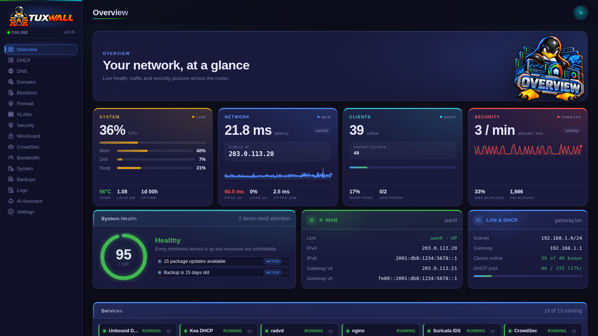
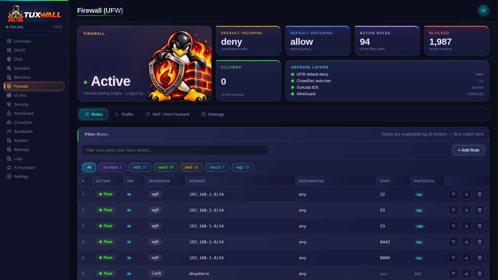
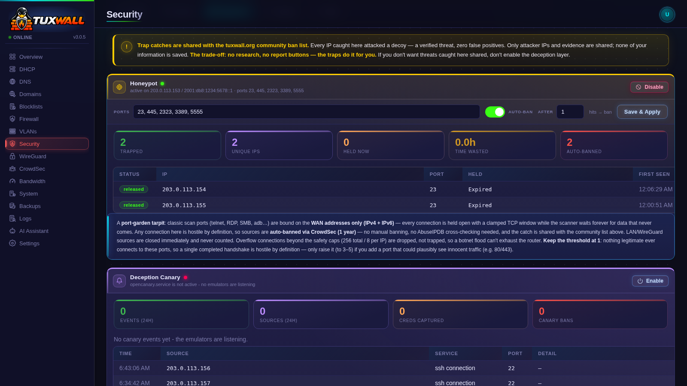
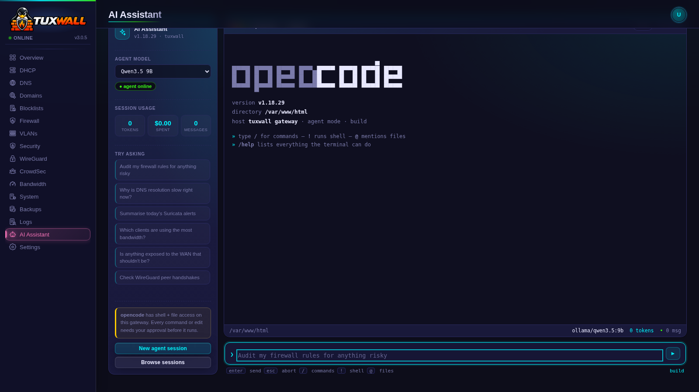
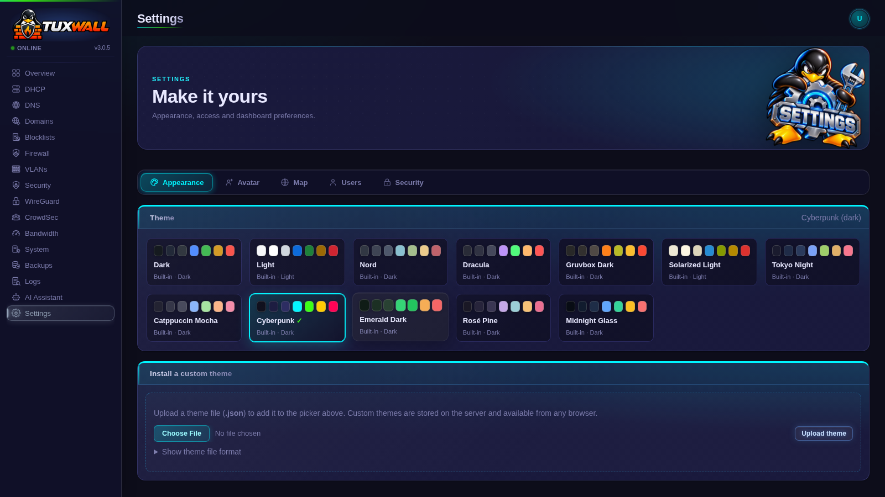

<p align="center">
  
</p>

<p align="center">
  <strong>Turn any Ubuntu server into an open-source Linux firewall and router.</strong><br>
  DHCP, DNS filtering, firewall rules, WireGuard, intrusion detection, deception and an AI assistant — in one browser tab on hardware you own.
</p>

<p align="center">
  <a href="https://github.com/rezzonance/tuxwall/releases"></a>
  <a href="#license"></a>
  <a href="#requirements"></a>
  <a href="https://tuxwall.org"></a>
  <a href="https://forum.tuxwall.org"></a>
</p>

---

TuxWall is a web-based network dashboard for a **dedicated Linux gateway or router** — a headless machine sitting between your modem and your LAN switch, doing the real work.

It does not replace your networking services. It **reads from and controls** Kea, Unbound, UFW, WireGuard, Suricata, CrowdSec and radvd through one unified interface, while every setting remains a standard, inspectable file on disk.

The base is stock Ubuntu. `apt`, `systemd`, `journalctl` and every tool you already know keep working. Install TuxWall, and your gateway keeps routing; remove it, and the underlying services keep running.

**[Website](https://tuxwall.org) · [Feature guide](https://tuxwall.org/help.html) · [Config reference](https://tuxwall.org/configs.html) · [Community forum](https://forum.tuxwall.org) · [Community bans](https://tuxwall.org/bans)**

## Table of Contents

- [Why TuxWall](#why-tuxwall)
- [Screenshots](#screenshots)
- [Features](#features)
- [How it fits together](#how-it-fits-together)
- [Requirements](#requirements)
- [Installation](#installation)
- [First login](#first-login)
- [Configuration](#configuration)
- [Plugins](#plugins)
- [AI assistant](#ai-assistant)
- [Security and community data](#security-and-community-data)
- [Updating and removing](#updating-and-removing)
- [Troubleshooting](#troubleshooting)
- [Support the project](#support-the-project)
- [Contributing](#contributing)
- [License](#license)

---

## Why TuxWall

- **No custom distro.** Stock Ubuntu LTS underneath. No appliance image to learn, no vendor kernel, no locked bootloader.
- **No lock-in.** TuxWall drives standard services with their standard configs. Uninstall the dashboard and your gateway is still a Linux gateway.
- **Safe to experiment.** Firewall baselines can be restored atomically, so a bad rule does not lock you out of your own network.
- **One pane of glass.** DHCP, DNS, firewall, VPN, IDS, traffic shaping, users and backups share a single UI and a single login.
- **Works from first boot.** The package writes working defaults for Kea, Unbound, radvd, forwarding/NAT and UFW on a fresh install. Hand-tuned configs are never clobbered on upgrade.

## Screenshots



<p align="center"><em>Overview — live health, traffic, services and security posture at a glance.</em></p>

<p align="center">
  <a href="images/screenshots/latest-firewall.png"></a>
  <a href="images/screenshots/latest-deception.png"></a>
</p>
<p align="center"><em>Firewall — interface filters and colour-coded rules. &nbsp;·&nbsp; Deception — honeypot and canary traps.</em></p>

<p align="center">
  <a href="images/screenshots/latest-ai.png"></a>
  <a href="images/screenshots/latest-settings.png"></a>
</p>
<p align="center"><em>AI Assistant — the opencode agent on your gateway. &nbsp;·&nbsp; Settings — themes, users and two-factor authentication.</em></p>

## Features

### Routing and firewall

| Feature | What it does | Under the hood |
|---|---|---|
| **Firewall rules** | View, add, remove and reorder rules; inspect the live backend. | UFW, nftables, iptables |
| **VLANs and DMZ** | Create segmented networks and inter-VLAN policies from the UI. | UFW route rules, netplan |
| **NAT and forwarding** | Persisted WAN masquerade and LAN-to-WAN forwarding on a default-deny posture. | UFW, sysctl |
| **Traffic shaping** | CAKE qdisc for bufferbloat reduction and per-host fairness, with a guided speed test. | `tc`, CAKE |
| **Restore baselines** | Save and restore known-good firewall rulesets with atomic rollback. | `iptables-restore` |

### Addressing and DNS

| Feature | What it does | Under the hood |
|---|---|---|
| **DHCP leases and reservations** | Live active/expired leases, static reservations and per-interface pools. | Kea DHCPv4 |
| **IPv6 router advertisements** | Advertise prefixes and DNS to the LAN; track ISP prefix delegation. | radvd, DHCPv6-PD, SLAAC |
| **DNS filtering** | Recursive resolution, local domains, blocklists and RPZ policies with hot reload. | Unbound |
| **DNS upstreams** | Eleven presets plus custom LAN resolvers, with DNS-over-TLS support. | Unbound `forward-zone` |
| **Threat feeds** | Subscribe to blocklist and RPZ feeds with automatic refresh. | Unbound, RPZ |

### Security and visibility

| Feature | What it does | Under the hood |
|---|---|---|
| **Intrusion detection** | Network threat detection on WAN and LAN with daily rule updates. | Suricata IDS/IPS |
| **Collaborative blocking** | Local decisions and community threat intelligence with automatic bans. | CrowdSec |
| **Honeypot tarpit** | WAN-only port garden that holds scanners open and auto-bans completed handshakes. | Built into the dashboard |
| **Deception canaries** | SSH, VNC, MSSQL, Redis and SNMP emulators that capture credential sprays. | OpenCanary |
| **File integrity** | Baseline and nightly AIDE checks with section-aware change reporting. | AIDE |
| **Attack map and bandwidth** | Live attacker geography, per-client traffic and top talkers. | Leaflet, nftables counters |
| **Community bans** | Trap catches are shared as verified threat evidence and consumed as a public ban list. | tuxwall.org collector |

### Management

| Feature | What it does | Under the hood |
|---|---|---|
| **AI assistant** | An embedded agent that can inspect the box, audit rules and edit configs — with approval for every action. | opencode |
| **Users and 2FA** | Per-user admin rights, TOTP enrollment with QR codes and replay protection. | Built into the dashboard |
| **Backups and restore** | Full-system archives, include/exclude lists, single-file restore and sanitized exports. | rsync, tar, systemd |
| **Themes** | Twelve built-in themes plus custom JSON themes and a profile avatar. | Built into the dashboard |
| **Plugins** | Isolated extensions for access points, certificates and external exposure checks. | Sandboxed worker processes |
| **System info and updates** | Platform, CPU, memory, storage, network, service controls and package updates. | systemd, apt, `/api/system` |
| **Diagnostics** | Connectivity checks, service status, logs and firewall safety tools. | Built into the dashboard |

## How it fits together

```text
Browser (LAN or VPN)
        │  HTTP :80
        ▼
      nginx ──► tuxwall API (Python, loopback :8008)
                    │
                    ├── Kea DHCPv4 / radvd
                    ├── Unbound  (DNS, blocklists, RPZ)
                    ├── UFW / nftables / iptables
                    ├── WireGuard
                    ├── Suricata + CrowdSec
                    └── opencode agent (loopback :4096)
```

The dashboard is served by nginx from `/var/www/html`; the Python API runs as `tuxwall.service` on `127.0.0.1:8008`. nginx is configured to allow loopback, RFC1918 and `fd00::/8` clients only, so the dashboard is reachable from your LAN and WireGuard network, not from the WAN.

## Requirements

- **Ubuntu 24.04 LTS or newer** on x86_64. Ubuntu **26.04 LTS** is the current recommendation. A stock server install is enough; no custom ISO is required.
- **Two network interfaces:** one for **WAN** (modem/ONT) and one for **LAN** (switch/access points). A VM with two virtual NICs also works for testing.
- **Root or sudo access** and an internet connection during installation.
- The machine should be your network's gateway. For a typical setup, put the ISP modem in bridge mode and give the WAN interface a DHCP or static address.

TuxWall is designed for a dedicated gateway. Running it on your desktop or on a machine that is not the default gateway will work as a dashboard, but routing, DHCP and DNS features will not apply to your network as intended.

## Installation

There are four supported paths. They all install the same dashboard; they differ in how much of the host the installer configures.

### 1. APT repository — recommended

Adds the signed TuxWall repository and installs the package in one step:

```bash
curl -fsSL https://rezzonance.github.io/tuxwall/install-repo.sh | sudo bash
```

Future updates are normal APT updates:

```bash
sudo apt update && sudo apt upgrade tuxwall
```

The package installs the dashboard, enables its services, and writes basic working configs for the gateway stack (Kea DHCP, Unbound with DNSSEC, radvd, IPv4/IPv6 forwarding, WAN NAT and a default-deny UFW posture). It does not overwrite configs you have already hand-tuned.

> **Optional packages:** CrowdSec, its firewall bouncer, GeoIP and the Ookla speedtest are shipped as `Suggests`, so a bare APT install does not pull them in. Install them explicitly if you want those integrations:
>
> ```bash
> sudo apt install crowdsec crowdsec-firewall-bouncer-iptables python3-maxminddb
> ```
>
> `setup.sh` installs CrowdSec and the bouncer for you, and tries the official Ookla tarball.

<details>
<summary>Manual APT setup (if you prefer not to pipe a script)</summary>

```bash
curl -fsSL https://rezzonance.github.io/tuxwall/public.asc \
  | sudo gpg --dearmor -o /usr/share/keyrings/tuxwall.gpg

echo "deb [signed-by=/usr/share/keyrings/tuxwall.gpg] https://rezzonance.github.io/tuxwall stable main" \
  | sudo tee /etc/apt/sources.list.d/tuxwall.list

sudo apt update
sudo apt install tuxwall
```
</details>

### 2. Full provisioning from source — `setup.sh`

Use this on an existing Ubuntu machine when you want the repository's installer to configure the host end to end. It installs dependencies, retires `systemd-resolved`, enables forwarding, configures Unbound/nginx/UFW/Avahi, installs the dashboard and systemd units, starts the services, and registers the APT repository for future updates.

```bash
git clone https://github.com/rezzonance/tuxwall.git
cd tuxwall
sudo bash setup.sh
```

### 3. Appliance wizard — `install.sh`

Use this on a freshly installed stock Ubuntu server you want to turn into a TuxWall gateway. It stages the appliance payload and installs a one-time first-boot autologin. On your next login, a guided WAN/LAN wizard asks which interface is WAN and which is LAN, then configures the full stack.

```bash
git clone https://github.com/rezzonance/tuxwall.git
cd tuxwall
sudo bash install.sh
```

After it finishes, **log out or reboot**. The wizard runs once on the next login and restores normal login afterwards. This is the only path that uses the first-boot wizard; APT and `setup.sh` installs are ready immediately.

### 4. Manual `.deb`

Download the current package from [Releases](https://github.com/rezzonance/tuxwall/releases), then:

```bash
sudo dpkg -i tuxwall_3.2.4_all.deb
sudo apt -f install
```

The second command resolves any missing dependencies. Replace the filename with the version you downloaded.

### Verify the install

```bash
systemctl --no-pager -l status \
  tuxwall nginx unbound kea-dhcp4-server radvd suricata
```

If CrowdSec is installed, include it as well:

```bash
systemctl status crowdsec
```

Then open the dashboard from a device on your LAN or VPN:

```text
http://<gateway-lan-ip>/
```

### Optional configuration

The dashboard covers day-to-day changes. For a complete reference of every config file TuxWall touches — netplan, sysctl, UFW, Kea, Unbound, radvd, WireGuard, nginx, systemd and the opencode agent — see **[tuxwall.org/configs.html](https://tuxwall.org/configs.html)**. The site also includes a gateway config generator if you prefer to build the files yourself.

## First login

There are **no default credentials**. On a fresh install, the dashboard opens a one-time administrator setup page:

1. Create the first administrator account with a strong password.
2. Sign in and open **Settings → Users** to add any additional admins or read-only viewers.
3. Enroll TOTP in **Settings** if you want two-factor authentication.
4. Review **Settings → Plugins** to enable optional integrations.

The dashboard is restricted to your LAN/VPN by nginx. If you cannot reach it, confirm the LAN interface has an address and that nginx is running:

```bash
ip -br address
systemctl status nginx
```

## Configuration

Most settings are available from the dashboard and are written directly to the underlying service's standard config file. You can hand-edit those files at any time; TuxWall reads the result on the next reload.

| Path | Purpose |
|---|---|
| `/etc/tuxwall/` | Dashboard settings, `opencode.json`, `llm.json`, `sqm.conf` |
| `/etc/unbound/unbound.conf.d/` | DNS, local domains, blocklists and RPZ zones |
| `/etc/kea/kea-dhcp4.conf` | DHCP subnets, pools and reservations |
| `/etc/radvd.conf` | IPv6 router advertisements |
| `/etc/ufw/` | Firewall and NAT rules |
| `/etc/wireguard/wg0.conf` | WireGuard interface and peers |
| `/etc/suricata/suricata.yaml` | IDS/IPS interfaces and HOME_NET |
| `/etc/nginx/sites-available/tuxwall` | Dashboard vhost and LAN/VPN access lists |

Useful service commands:

```bash
sudo systemctl restart tuxwall          # dashboard API
sudo systemctl reload nginx             # dashboard vhost
sudo systemctl restart kea-dhcp4-server # DHCP
sudo systemctl restart unbound          # DNS
sudo systemctl restart radvd            # IPv6 RAs
```

For traffic shaping, set the WAN interface and rates from **System → Traffic Shaping**, or edit `/etc/tuxwall/sqm.conf` and run:

```bash
sudo systemctl enable --now tuxwall-sqm
```

## Plugins

Plugins add a view, an API surface, or an alert source without changing the core dashboard. Each backend runs as an isolated unprivileged worker; credentials stay on the router in `/etc/tuxwall/plugins/<id>/config.json` and are never committed.

Install and update plugins from **Settings → Plugins → Available Plugins**, or browse the source in [`plugins/`](plugins).

| Plugin | Description |
|---|---|
| [UniFi Access Points](plugins/wifi-unifi-plugin) | Read-only UniFi controller view: access points, clients, signal and roaming context. Supports classic Network Application, UniFi OS (UDM / Cloud Key), local login or API key. |
| [OpenWrt Access Points](plugins/wifi-openwrt-plugin) | OpenWrt AP view and optional management: access points, clients, signal, roaming events, RF channel advisor and SSID management over SSH. |
| [Certificate Watch](plugins/cert-watch-plugin) | TLS certificate expiry monitoring. Reads the certificate each endpoint actually presents and raises incidents through the dashboard's alert bell, with renewal guidance. |
| [Perimeter Watch](plugins/perimeter-watch-plugin) | Keyless external exposure audit: what Shodan observes open on your WAN versus what you intend, plus CrowdSec CTI reputation. Alerts through the dashboard's alert bell. |

Third-party plugins can be installed from any public GitHub folder containing `plugin.json`, `main.py` and an optional `web/` directory. Browse the [bundled plugin source](plugins) for working examples of the worker contract.

## AI assistant

The **AI Assistant** page embeds an [opencode](https://opencode.ai) agent running on the gateway as `tuxwall-agent.service` on `127.0.0.1:4096`.

It can inspect the system, audit firewall rules, tune DNS, read logs and edit config files — but **every command and file change requires your approval in the dashboard before it runs**. The agent runs with a deliberately narrow sudo allowlist for named service actions, not blanket root access.

A fresh install ships a working `opencode.json` that uses opencode's free hosted models with a conservative read-only permission set, so the assistant works with zero setup. For a fully local deployment, point it at Ollama. Models and permissions live in:

```text
/etc/tuxwall/opencode.json
```

Existing installs keep their configured copy on upgrade.

## Security and community data

TuxWall is a security appliance, so a few defaults matter:

- **No default password.** The first administrator is created interactively; the setup endpoint refuses to run once any user exists.
- **Dashboard is LAN/VPN only.** nginx allows loopback, RFC1918 and `fd00::/8` clients. Do not expose port 80/443 to the WAN.
- **Use 2FA.** TOTP works with Google Authenticator, Aegis, 1Password and any standard authenticator. Replay protection is built in.
- **Backups contain secrets.** Full backups include `auth.json`, WireGuard private keys and service credentials. Use the sanitized export when sharing a backup.
- **The deception layer is deliberate exposure.** The honeypot tarpit and OpenCanary emulators bind WAN-only ports that no legitimate client should use. They can be disabled from the Deception page.
- **Community reporting is deception-only and always on.** When a trap catches a completed connection, the attacker IP and evidence are reported to the tuxwall.org community ban list. Configs, logs and personal data are never shared. If you do not want catches from your gateway shared, do not enable the deception layer. Full details are shown on the Deception page.

Read-only viewers cannot change firewall rules, restart services, read backups or drive the AI agent; admin rights are required for every destructive action, and the check is enforced server-side.

## Updating and removing

Update an APT install:

```bash
sudo apt update && sudo apt upgrade tuxwall
```

The dashboard itself can also check for package updates from the **System** page.

Remove the dashboard:

```bash
sudo apt remove tuxwall
```

Purge package configuration and TuxWall state as well:

```bash
sudo apt purge tuxwall
```

Removing TuxWall stops the dashboard. The networking services it was managing — Kea, Unbound, UFW, WireGuard, Suricata, CrowdSec — keep running with their existing configs, so your gateway keeps routing.

## Troubleshooting

Start with the service and log checks:

```bash
systemctl --no-pager -l status tuxwall nginx unbound kea-dhcp4-server radvd
sudo journalctl -u tuxwall -n 100 --no-pager
sudo nginx -t
sudo unbound-checkconf
```

**Dashboard not loading**

```bash
systemctl status tuxwall nginx
sudo journalctl -u nginx -n 50 --no-pager
```

Confirm you are connecting from the LAN/VPN and not from the WAN, and that the LAN interface has an address (`ip -br address`).

**DNS not resolving**

```bash
systemctl status unbound
ss -ulnp | grep ':53 '
dig @127.0.0.1 example.com
```

Only Unbound should be listening on port 53. If `systemd-resolved` is active, it is fighting Unbound for the same socket; the installer retires it on supported paths.

**DHCP leases not appearing**

```bash
systemctl status kea-dhcp4-server
ls -lh /var/lib/kea/kea-leases4.csv
```

**CrowdSec is blocking something legitimate**

```bash
sudo cscli decisions list
sudo cscli decisions delete --ip <address>
```

**A firewall change locked you out**

Restore the last saved baseline from **Firewall → Baselines**, or from the console reset UFW and re-add your management rule.

More detail is available in the [TuxWall feature guide](https://tuxwall.org/help.html). If you are still stuck, open an issue with the output of the service checks above and a description of your WAN/LAN setup.

## Support the project

TuxWall is built and maintained on minimal hardware with limited resources. If it saves you time or runs your gateway, consider supporting development:

- [Donate via PayPal](https://www.paypal.com/ncp/payment/GY6799FZ4ZPB2)
- [Join the community forum](https://forum.tuxwall.org)
- [Report an issue](https://github.com/rezzonance/tuxwall/issues)
- Star the repository or share it with someone building a home gateway

## Contributing

1. Fork the repository.
2. Create a feature branch: `git checkout -b feature/my-feature`
3. Make your change and test it on a live gateway where possible.
4. Commit with a clear message: `git commit -m "Add my feature"`
5. Push the branch: `git push origin feature/my-feature`
6. Open a pull request describing the problem and the change.

For larger changes, open an issue first so the approach can be discussed. Please keep pull requests focused, preserve the standard config-file model, and include the service checks you ran when the change affects networking or firewall behaviour.

## License

TuxWall is released under the **MIT License**.

---

<p align="center">
  <a href="https://tuxwall.org">tuxwall.org</a> ·
  <a href="https://forum.tuxwall.org">Forum</a> ·
  <a href="https://github.com/rezzonance/tuxwall">GitHub</a> ·
  <a href="https://tuxwall.org/bans">Community bans</a>
</p>
